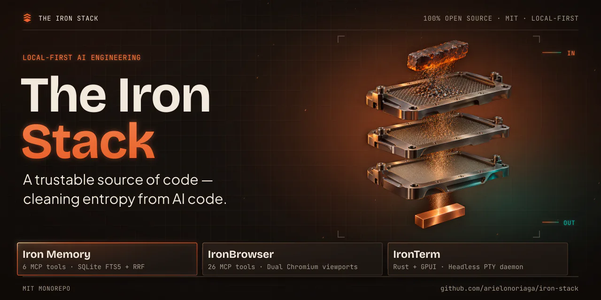
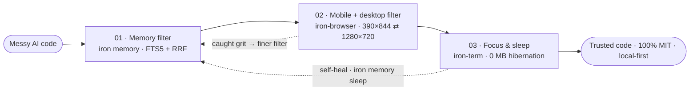
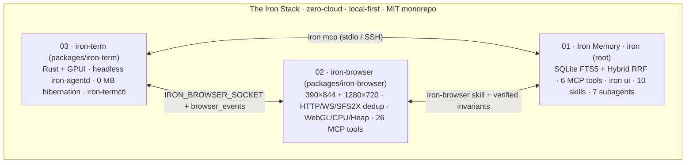
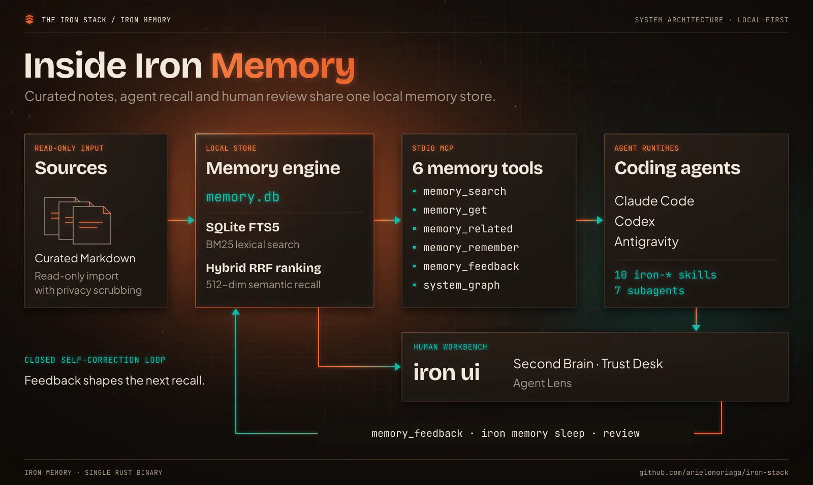
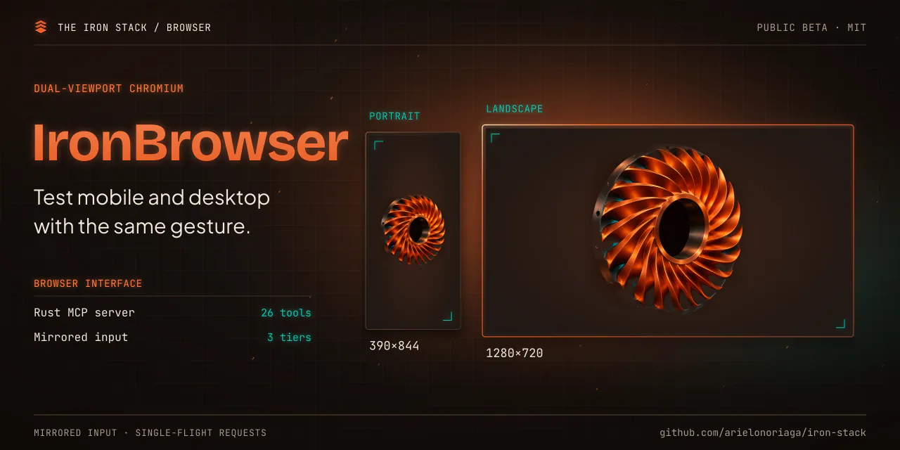
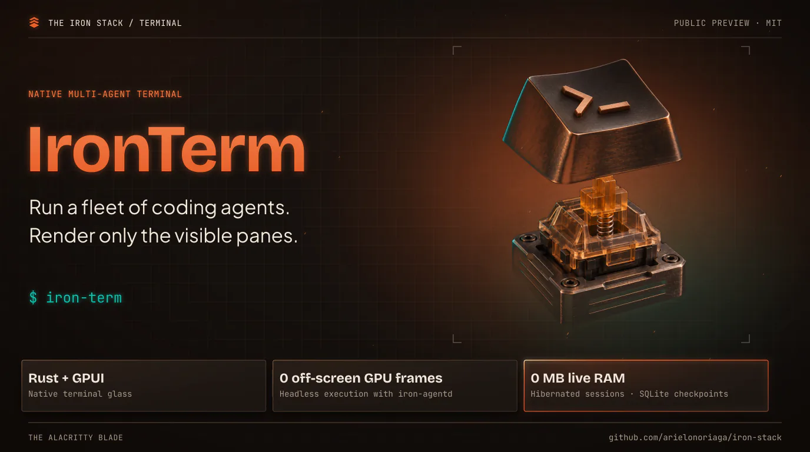

<p align="center">
  
</p>

<p align="center"><sub><b>100% OPEN SOURCE · MIT MONOREPO · LOCAL-FIRST · ZERO LOCK-IN</b></sub></p>

<h1 align="center">The Iron Stack</h1>

<h3 align="center">A trustable source of code — cleaning entropy from AI code.</h3>

<p align="center">
Raw AI output enters noisy and brittle. Iron's local gates remember what was learned, test mobile and desktop side-by-side, catch defects before they ship, and feed every failure back to harden the system — delivering clean, verified MIT code with <b>zero cloud keys</b> and <b>zero lock-in</b>.
</p>

<p align="center">
  <a href="https://iron.huggian.com"></a>
  <a href="https://crates.io/crates/iron-stack"></a>
  <a href="https://registry.modelcontextprotocol.io/v0.1/servers?search=iron-stack"></a>
  <a href="packages/iron-browser"></a>
  <a href="packages/iron-term"></a>
  <a href="LICENSE"></a>
</p>

<p align="center">
  <a href="https://mcprush.com/to/iron-suite-zero-cloud-sqlite-fts5-memory-hub-mcp?ref=badge"></a>
</p>

<p align="center">
  <a href="#install-locally-mit"><b>Install Locally (MIT) ↓</b></a> ·
  <a href="https://iron.huggian.com"><b>View Live Ecosystem Flow ↗</b></a> ·
  <a href="#monorepo-layout"><b>Inspect MIT Monorepo ↓</b></a>
</p>

| `~878 ns` | `32 tools` | `390 + 1280` | `100% MIT` |
| :---: | :---: | :---: | :---: |
| Rust N-API causal `TabEventBus` | 26 browser + 6 memory bounded-byte MCP | Simultaneous Portrait & Landscape | Local SQLite, Unix sockets & PTY · 0 cloud |

The Iron Stack augments the coding agents you already use (**Claude Code, Codex, OpenCode, Cursor, Antigravity**) over `stdio` MCP, `0600` Unix domain sockets, and plain SSH — **no vector clouds, no telemetry, no hosted API keys, no heavyweight orchestration wrappers.**

---

## The Cleanroom Loop

> **CLOSED LOOP · EVERY STAGE MAPS TO SHIPPED CODE**

Messy AI code passes three filter screens. Whatever they catch is routed back as a finer filter, so the same class of defect never ships twice.



| | Pillar | Status | What it does |
| :--- | :--- | :--- | :--- |
| **01** | **[Iron Memory (`iron`)](#01--iron-memory--available-now--v031)** · root (`src/`, `skills/`, `agents/`) | 🟢 **Available Now · `v0.3.1`** | SQLite FTS5 + 512-dim Hybrid RRF memory hub (6 stdio MCP tools), `iron ui` Second Brain, 10 `iron-*` skills & 7 subagents. |
| **02** | **[iron-browser](#02--iron-browser--public-beta--v011)** · [`packages/iron-browser/`](packages/iron-browser) | 🟠 **Public Beta · `v0.1.1`** | Dual-viewport Chromium, single-flight HTTP/WS/SSE/SFS2X dedup, WebGL & off-thread V8 CPU/Heap labs, 8-edge Agent Chat Dock, **26 MCP tools**. |
| **03** | **[iron-term](#03--iron-term--public-preview--v010)** · [`packages/iron-term/`](packages/iron-term) | 🔵 **Public Preview · `v0.1.0`** | Native Rust + GPUI fleet terminal (*Alacritty Blade*): headless `iron-agentd`, 0 off-screen GPU frames, 0 MB hibernation, Whisper Rail, `iron-termctl`. |



<p align="center">
  
</p>

---

## Install Locally (MIT)

> **ONE INSTALLER · `--browser` · `--term` · `--all`**

```sh
# Default: iron CLI/MCP binary + 10 iron-* skills + 7 subagents + Claude Code MCP registration
curl -fsSL https://raw.githubusercontent.com/arielonoriaga/iron-stack/main/install.sh | bash

# Add iron-browser (needs bun + cargo) and/or iron-term (needs cargo)
curl -fsSL https://raw.githubusercontent.com/arielonoriaga/iron-stack/main/install.sh | bash -s -- --browser
curl -fsSL https://raw.githubusercontent.com/arielonoriaga/iron-stack/main/install.sh | bash -s -- --term
curl -fsSL https://raw.githubusercontent.com/arielonoriaga/iron-stack/main/install.sh | bash -s -- --all
```

<table>
<tr>
<td valign="top">

**Skills only** · `skills.sh` (Claude Code, Codex, Cursor, Antigravity)
```sh
npx skills add arielonoriaga/iron-stack
```

</td>
<td valign="top">

**Claude Code plugin marketplace**
```text
/plugin marketplace add arielonoriaga/iron-stack
/plugin install iron-stack@iron-stack-marketplace
```

</td>
<td valign="top">

**Cargo** · `iron` memory CLI + MCP server
```sh
cargo binstall iron-stack
# or from source
cargo install --git https://github.com/arielonoriaga/iron-stack --locked
```

</td>
</tr>
</table>

Coming from another memory MCP (the official knowledge-graph server, mem0, basic-memory, Cavemem or plain `MEMORY.md`)? Follow **[Migrating to Iron Memory](docs/migrating-to-iron.md)**.

---

## 01 / IRON MEMORY · AVAILABLE NOW · `v0.3.1`

### Persistent Second Brain memory and adversarial review gates that never drift.

One Rust binary (`iron`) gives every CLI agent a local SQLite FTS5 + 512-dim Hybrid Reciprocal Rank Fusion memory hub at `~/.local/share/iron/memory.db`, with stdio MCP tools, an interactive Second Brain, Trust Desk & Agent Lens UI (`iron ui`), 10 skills and 7 subagents.

| | |
| :--- | :--- |
| **Independent adversarial review** | Non-trivial work cannot finish until a fresh-context reviewer audits raw receipts on the final commit SHA and returns 0 findings. |
| **Bug → invariant backpropagation** | Every post-mortem or test flake traces root cause and records a permanent guard, so the same class of bug never ships twice. |
| **Zero-cloud `memory.db`** | No SaaS keys, vector cloud bills, or leaked proprietary code. Hybrid RRF + FTS5 BM25 recall shared across Claude Code, Codex, and Antigravity. |

| Capability | Plain `MEMORY.md` | Cloud vector MCPs | **Iron Memory `v0.3.1`** |
| :--- | :--- | :--- | :--- |
| **Zero cloud / zero API keys** | Yes | No (hosted / paid) | **Yes (single Rust binary + SQLite)** |
| **Hard byte budget (`--max-bytes`)** | No (dumps whole files) | Rarely | **Yes (exact UTF-8 serialized cap)** |
| **Detects stale rules when code changes** | No | No | **Yes (`git ls-files` drift decay)** |
| **Detects contradicting rules** | No | No | **Yes (nightly `iron memory sleep`)** |
| **Multi-machine without sync conflicts** | No | Yes (via cloud) | **Yes (plain `ssh` stdio hub)** |
| **Visual Second Brain & verification UI** | No | Hosted dashboard | **Yes (embedded local `iron ui`)** |
| **Role isolation (`reviewer` = curated only)** | No | No | **Yes (built-in + `iron-*` skills)** |

```sh
# Import curated Markdown memories read-only & search under a strict UTF-8 byte ceiling
iron memory import --claude-root ~/.claude
iron memory search 'tenant isolation' --project commerce-core --strict-project --max-bytes 2000

# Save replay-safe notes/corrections & run nightly drift/contradiction consolidation
iron memory remember --project iron-stack --agent claude --kind correction \
  --supersedes mem_OLD_ID --title 'Shared memory hub' --content 'One hub host holds the authoritative store.'
iron memory sleep --repos-root ~/Projects

# Launch the zero-dependency Second Brain & Trust Desk web UI (loopback by default)
iron ui --port 7420
```


#### Memory fitness — ranked, not hoarded

Memories earn their rank. Stale rules sink. Every recall, helpful vote and verified outcome adds evidence; one bounded formula ranks them:

```text
score = weight × (1 + 0.45·e ⁄ (4 + e)) × (superseded ? 0.15 : 1) ⁄ (1 + 0.4·contradictions)
e     = uses + 2·confirms          weight: correction 2.2 · curated 2.0 · history 1.0
```

Corrections outweigh history, reinforcement saturates at **+45%**, a superseded memory keeps **15%** of its weight, and every contradiction divides its score. `memory_get` reinforces an id once per session; `iron memory feedback --outcome helpful` and `iron memory outcome --outcome pass` add confirmations. The nightly `iron memory sleep` pass queues opposing rules for review and reports consolidation candidates.

#### Memory MCP server (`iron mcp` · 6 tools)

| Tool | What it does |
| :--- | :--- |
| `memory_search` | Hybrid FTS5 BM25 + pure-Rust 512-dim RRF ranking, bounded Hebbian reinforcement, supersession decay, role scoping (`developer`/`reviewer`/`verifier`), strict `max_bytes` (`256..65536`). |
| `memory_get` | UTF-8 byte-paginated retrieval (`offset`/`next_offset`) with cold `archive.db` fallback. Record IDs only. |
| `memory_related` | Traverses explicit `references`, `supersedes`, `co_used`, and high-IDF cross-session `shares_anchor` edges. |
| `memory_remember` | Replay-safe note & correction persistence with `<private>`/credential redaction before hashing. |
| `memory_feedback` | Reinforces `helpful` memories or demotes `outdated`/`contradicted` entries. |
| `system_graph` | Cross-repo service graph queries: `{query, direction: callers\|callees\|impact}` (see below). |

#### Zero-cloud multi-machine hub over SSH

Run one hub host with the authoritative SQLite WAL store and point any number of other devices at it over plain SSH — no open ports, no sync conflicts:

```json
{
  "mcpServers": {
    "iron-memory": {
      "command": "ssh",
      "args": ["-T", "-o", "BatchMode=yes", "-o", "ConnectTimeout=12", "iron-hub", ".local/bin/iron", "mcp"]
    }
  }
}
```

See [docs/ssh-hub-rollout.md](docs/ssh-hub-rollout.md) for running one hub with any number of devices (memory over SSH, a per-device system graph, verified pairs shared through any file sync) and `integration/` for `systemd --user` timers.

#### System graph — cross-repo "who calls what" (`iron memory graph`)

A deterministic map of how your services talk to each other, built from code with **zero LLM tokens** and stored in `graph.db` next to `memory.db`.

- **Extracts:** Axum routes (incl. `nest`/`merge` prefixes and multi-line `.route(`), Rust reqwest clients (`format!("{}/path", self.base_url)` + same-file wrappers), and SPA clients (`api.<group>.<call>()` resolved through the client file, grouped by page).
- **Links:** config (`clients`, `env`, `prefixes`) → unique `(method, path)` across all providers → name hint → suffix. Anything unresolved is reported as **fog**, never dropped.
- **Incremental:** per-file blob hashes; a no-change refresh takes tens of ms, and `graph touch <file>` re-maps one edited file from the working tree.
- **Self-improving:** `graph suggest [--apply]` learns mount prefixes, external hosts and env→service rules from fog; `graph changes` shows added/removed cross-repo edges over time.

```sh
cp integration/system-graph.example.json ~/.local/share/iron/system-graph.json   # describe your services
iron memory graph refresh
iron memory graph who-calls "POST /api/internal/invoices"
iron memory graph impact --file ~/Projects/worker/src/clients/shop.rs
iron memory graph fog && iron memory graph suggest --apply
```

With `install.sh --hooks`, Claude Code gets two PostToolUse hooks: **Read** of a memory file credits it to the session (so verify verdicts reinforce memories that were actually used), and **Edit/Write** of a source file re-maps it and injects a ≤300-byte impact note only when the file crosses a service boundary. `integration/iron-memory-refresh.service` refreshes the graph after each memory import.

---

## 02 / IRON-BROWSER · PUBLIC BETA · `v0.1.1`

### Verify 390×844 mobile and 1280×720 desktop in one single-flight window.

<p align="center">
  
</p>

Two live Chromium views side-by-side. Every click, PIN keystroke, dialog dismissal, and canvas drag mirrors across both viewports — while HTTP mutations, WebSockets, SSE, and binary SFS2X streams collapse onto **a single upstream flight**. Mirrored clicks never double-charge a card.

- **Full-stack single-flight dedup** — deduplicates concurrent `POST`/`PUT`/`PATCH`/`DELETE` mutations (correlation-ID remapping, gzip/br/deflate decompression), multiplexes WebSockets + SSE + **SmartFoxServer 2X (`SFS2X`)** binary frames over one upstream socket, and syncs `sessionStorage` + zero-reload `spa_sync` routes across panes (`Shared` vs `Isolated` partitions).
- **Causal Rust `TabEventBus` (`~878 ns/op`) & visual forensics** — tags downstream network, storage, download, popup, and route events with their originating `gestureSeq`; exports clipped-overflow screenshots, deterministic frame-stepped PNG filmstrips (`browser_repro` / `browser_filmstrip`), and `before`/`during`/`after` mark traces.
- **POS hardware lab + off-thread CPU & heap** — WebGL/WebGL2 draw calls & stacking-context render order (`browser_webgl`), `sunmi-v2-pro` / `low-end-android` emulation (`browser_emulate`), and non-blocking V8 CPU (`browser_profile` inclusive `callTree`) and heap (`browser_heap` dominators, sampling, leak diffs) profilers in worker threads.
- **26 bounded-byte MCP tools + 8-edge Agent Chat Dock** — full tab lifecycle (`browser_open` with `background: true`, `browser_close_tab` single/bulk `{ session, all }`, `browser_select_tab`, `browser_reload`, `browser_navigate_history`, `browser_wait_for`, `browser_storage`, `browser_metrics` with `tab_id`), focus-safe `--smoke` headless mode, setup-agnostic Linux Wayland/X11 detection, and a floating dock for `agy`, `claude`, `codex`, `opencode`, a custom CLI, or a live `tmux`/iron-term attach with Markdown/code formatting.

→ Full package docs: [`packages/iron-browser/README.md`](packages/iron-browser/README.md)

---

## 03 / IRON-TERM · PUBLIC PREVIEW · `v0.1.0`

### Run dozens of CLI coding agents across desktop and laptop without melting RAM or focus.

<p align="center">
  
</p>

Built on the *Alacritty Blade* architecture: a headless Rust PTY daemon (`iron-agentd`) paired with a GPU-accelerated `iron-gpui` client, for engineers running **10–25+ concurrent CLI agents** across sibling git worktrees.

- **Strict daemon / renderer split** — only the 1–2 visible panes paint GPU frames (`95%` pure terminal glass); background sessions stay headless inside `portable-pty` + `alacritty_terminal` (`0` off-screen GPU frames); idle sessions hibernate to **`0 MB` live RAM** backed by SQLite checkpoints, todo checklists, workflow phases, and `--resume` tokens.
- **Urgency-first 236px Whisper Rail** — sessions group into `NEEDS YOU` · `ACTIVE` · `DORMANT (0 MB)` instead of dozens of tmux windows of raw ANSI.
- **1-line Ghost Action Bar** — when a guardrail or approval blocks an agent, press `[1]` run via `runq`, `[2]` allow, or `[3]` deny on the bottom hairline (`Ctrl+1/2/3` or `Alt+1/2/3`) — zero modal walls.
- **Portable socket discovery** — Fleet Overlay, Omnibox, native split panes, `IRON_TERM_SOCKET` / `IRON_TERM_HOSTS` host discovery, XDG `.desktop` installer, and a scriptable `iron-termctl` CLI over `0600` Unix domain sockets.

→ Full package docs: [`packages/iron-term/README.md`](packages/iron-term/README.md)

---

## 04 / ARCHITECTURAL PROOF

### Engineered for observable receipts, not demo-video theater.

Every tool enforces hard UTF-8 output byte budgets (`max_bytes` / `--max-bytes`), `0600` local socket permissions, and automatic URL/JWT/Bearer token redaction.

| Capability | Playwright / raw DevTools MCP | Cloud agent wrappers | **The Iron Stack (MIT)** |
| :--- | :--- | :--- | :--- |
| Simultaneous 390×844 + 1280×720 parity | Separate runs / manual resize | Single headless tab | **Live dual view at 60 fps** |
| Mirrored POST / WS / SSE / SFS2X dedup | Double-submits mutations | None | **Single-flight + correlation-ID remap** |
| Causal gesture → network/DOM trace | Unlinked raw logs | Opaque cloud logs | **Rust `TabEventBus` (~878 ns · `gestureSeq`)** |
| Off-thread V8 CPU callTree & heap diff | Blocks main loop / manual UI | Unavailable | **Worker dominators + leak diff under 6× CPU** |
| Cross-session memory & review gate | Stateless per chat | Vendor-locked cloud DB | **Local SQLite FTS5/RRF + 0-finding review** |
| Multi-agent multi-machine RAM footprint | N/A | One Electron/Node process per agent | **`iron-agentd` + 0 MB session hibernation** |

#### Design contracts & honest non-claims

- **Hard serialized UTF-8 byte budgets** — `--max-bytes` bounds serialized JSON output across `iron` and `iron-browser-mcp`; truncation sets `truncated: true` and is distinguished from empty matches.
- **Evidence, not authority** — recalled memories keep timestamps and source locators and never override live code verification or user authorization.
- **Best-effort redaction & `0600` local IPC** — memory imports, `TabEventBus`, structured logs, and profiler dumps scrub tokens/credentials and use `0600` sockets/files; heuristics do not replace secret managers.
- **Independent evaluation (`eval/`)** — fixtures verify byte-budget recall, replay idempotency, and subprocess latency without claiming unmeasured billed token savings.

---

## Bundled `iron-*` skills & subagents

| Skill | Purpose |
| :--- | :--- |
| **`iron-design`** | Ground-truth UX/UI orchestrator: FE + BE + anonymized prod audit → `UX.md` → 3 structurally distinct proposals + Gen-2 recombination in an isolated `390px` + desktop UX Lab → Plain-to-Magic elevation → verified handoff to `irondev`. |
| **`iron-browser`** | Dual-viewport verification skill driving iron-browser's **26-tool** MCP server (`browser_open` `background`, `browser_close_tab`, `browser_webgl`, `browser_emulate`, `browser_profile`, `browser_heap`, `browser_events`, `--smoke`). |
| **`irondev`** | End-to-end feature/fix orchestrator: bounded implementer brief → fresh-context adversarial review → real-surface verification → curated learning. |
| **`irondev-dev`** | Shared implementation discipline for backend, frontend, and security roles with canonical handoff contracts. |
| **`irondev-review`** | Fresh-context adversarial code review selecting correctness, architecture, systems, and security lenses proportional to risk. |
| **`iron-hunt`** | Read-only/sandboxed offensive vulnerability hunter: attack-surface mapping, scanner triage (`gitleaks`, `osv-scanner`, `semgrep`, `zizmor`, `ast-grep`), taint tracing, safe local repro, and `1 → N` variant sweeps. |
| **`iron-audit`** | Read-only multi-lens codebase health & pre-release sweep producing severity-ranked findings and remediation briefs. |
| **`iron-debug`** | Production-grade systematic debugging (`repro → hypothesis → instrument → root cause → fix → invariant backprop`). |
| **`iron-perf`** | Measurement-first performance engineering: baseline flamegraphs, query plans, and RUM evidence before any optimization edit. |
| **`iron-maintain`** | Instruction & memory hygiene: inventories CLAUDE.md/AGENTS.md/MEMORY.md, classifies each section (keep / route / memory / dup / stale / enforced) using `iron memory audit-drift` + `consolidate` signals, relocates knowledge, prunes, and proves no load-bearing rule was lost. |

**Subagents** (`agents/iron-*.md`): `iron-backend-dev` · `iron-backend-review` · `iron-frontend-dev` · `iron-frontend-review` · `iron-security-dev` · `iron-security-review` · `iron-verifier`

---

## Monorepo layout

> **`arielonoriaga/iron-stack` · MIT · SINGLE WORKSPACE · BUILD FROM SOURCE**

```text
iron-stack/
├── Cargo.toml                  # Root pure-Rust iron-stack crate (iron CLI + MCP + iron ui)
├── install.sh                  # Unified installer (--binary-only, --skills-only, --browser, --term, --all)
├── src/                        # SQLite FTS5 + Hybrid RRF memory engine, stdio MCP server & iron ui
├── skills/                     # 10 adversarial engineering, browser, UX & security skills (iron-*)
├── agents/                     # 7 role-isolated subagents (iron-*-dev, iron-*-review, iron-verifier)
├── eval/                       # Byte-budget recall, replay idempotency & subprocess latency benchmarks
├── integration/                # Claude Code hooks, systemd --user units, system-graph config
├── packages/
│   ├── iron-browser/           # Dual-viewport Chromium + Rust N-API TabEventBus + 26-tool iron-browser-mcp
│   └── iron-term/              # Native Rust + GPUI terminal (iron-gpui), iron-agentd, iron-termctl
└── docs/                       # SSH hub rollout, Second Brain UI & design contracts
```

Each package under `packages/` keeps its own `Cargo.toml` / toolchain, so `cargo install iron-stack`, the `Dockerfile`, and MCP Registry builds stay pure Rust — no Chromium/Electron or GPUI/Vulkan dependencies unless you ask for them.

### Build & verify

```sh
# Core Iron Memory + eval harness
cargo test --locked
python3 -m unittest discover -s eval -p test_runner.py -v

# iron-browser (unit + Rust bus & 26-tool MCP tests)
(cd packages/iron-browser/app && bun install && bun run build && bun test)
cargo test --manifest-path packages/iron-browser/Cargo.toml --workspace --no-fail-fast

# iron-term (Rust workspace tests)
cargo test --manifest-path packages/iron-term/Cargo.toml --workspace --no-fail-fast
```

### Companion open-source CLIs (MIT)

- **[entropy-hunter](https://github.com/arielonoriaga/entropy-hunter)** — deterministic software-entropy analyzer for Rust and TypeScript codebases.
- **[lazyfetch](https://github.com/arielonoriaga/lazyfetch)** — keyboard-driven terminal HTTP client (Rust + ratatui).
- **[claude-statusline-bar](https://github.com/arielonoriaga/claude-statusline-bar)** — information-dense terminal status line with live context, git, and rate-limit ramps.
- **[claude-harness](https://github.com/arielonoriaga/claude-harness)** — original self-improving Claude Code hooks & ratatui proposal queue (archived; succeeded by The Iron Stack).

---

<h3 align="center">100% Open Source. Zero lock-in. Inspect, fork, and forge locally.</h3>

<p align="center">
Every package in this monorepo is MIT-licensed and dogfooded daily on production SaaS, POS hardware, and WebGL systems at <a href="https://huggian.com">Huggian</a>.
</p>

<p align="center">
  <a href="https://iron.huggian.com"><b>iron.huggian.com</b></a> ·
  <a href="https://registry.modelcontextprotocol.io/v0.1/servers?search=iron-stack">Official MCP Registry</a> ·
  <a href="https://crates.io/crates/iron-stack">crates.io</a> ·
  <a href="https://glama.ai/mcp/servers/arielonoriaga/iron-suite">Glama MCP Servers</a>
</p>

<p align="center"><sub>MIT — Copyright (c) 2026 Ariel Onoriaga · Engineered at Huggian · Zero runtime telemetry · <code>mcp-name: io.github.arielonoriaga/iron-stack</code></sub></p>
