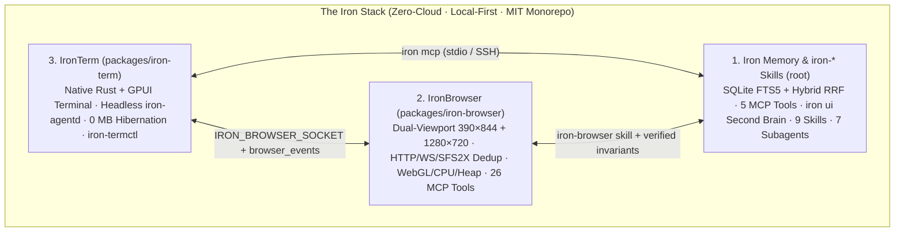
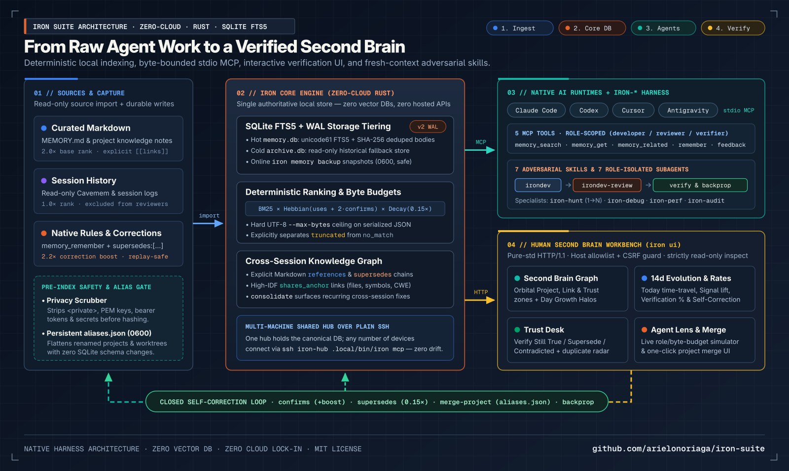
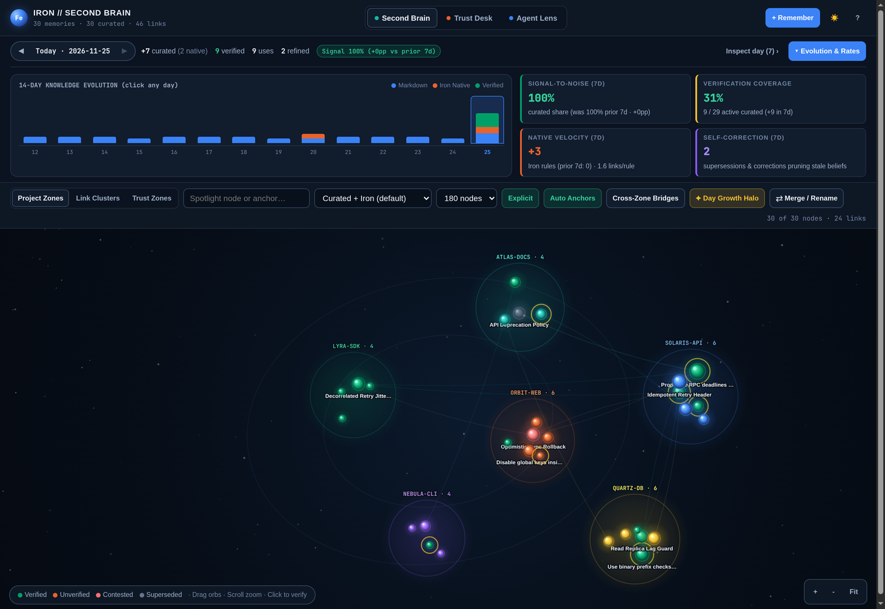
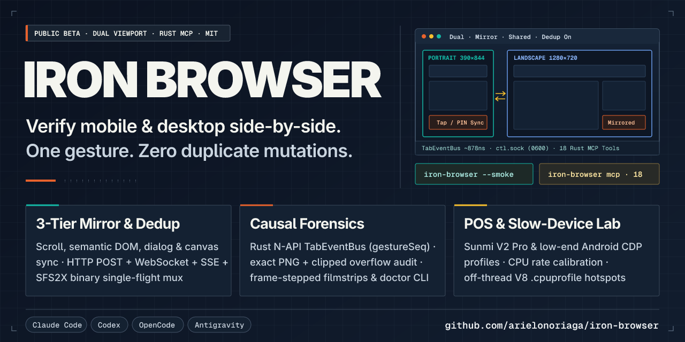
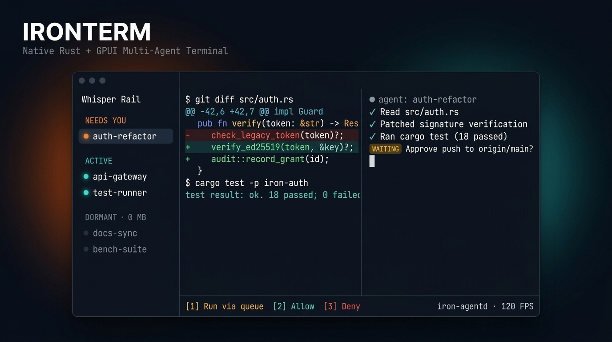

<p align="center">
  
</p>

# The Iron Stack

**The zero-cloud, local-first AI engineering stack — unifying bounded-byte SQLite FTS5 agent memory (`iron`), a dual-viewport 26-tool MCP developer browser (`packages/iron-browser`), a native Rust + GPUI multi-agent terminal (`packages/iron-term`), and 9 adversarial `iron-*` engineering skills in one MIT monorepo.**

[](https://iron.huggian.com) [](https://crates.io/crates/iron-suite) [](https://registry.modelcontextprotocol.io/v0.1/servers?search=iron-suite) [](packages/iron-browser) [](packages/iron-term) [](LICENSE)

The Iron Stack augments your existing coding agents (**Claude Code, Codex, OpenCode, Cursor, Antigravity**) over `stdio` MCP, `0600` Unix domain sockets, and plain SSH — with **zero vector clouds, zero telemetry, zero hosted API keys, and zero heavyweight orchestration wrappers**:

| Pillar | Location | Status | What It Does |
| :--- | :--- | :--- | :--- |
| **1. Iron Memory (`iron`) & `iron-*` Skills** | Root (`src/`, `skills/`, `agents/`) | **Stable (`v0.3.1`)** | Zero-cloud SQLite FTS5 + hybrid RRF MCP memory hub (`5` stdio tools), local `iron ui` Second Brain workbench, `9` engineering/UX/security skills, and `7` role-isolated subagents. |
| **2. [IronBrowser](packages/iron-browser)** | [`packages/iron-browser/`](packages/iron-browser) | **Public Beta (`v0.1.1`)** | Simultaneous `390×844` Portrait + `1280×720` Landscape Chromium browser, HTTP/WS/SSE/SFS2X dedup, WebGL & V8 CPU/Heap profilers, Rust `TabEventBus` (`~878 ns/op`), embedded multi-CLI Agent Chat Dock, and **26 MCP tools**. |
| **3. [IronTerm](packages/iron-term)** | [`packages/iron-term/`](packages/iron-term) | **Public Preview (`v0.1.0`)** | Native Rust + GPUI multi-agent terminal (*Alacritty Blade*): `95%` raw terminal glass, headless `iron-agentd` PTY daemon, `0` off-screen GPU frames, `0 MB` live-RAM SQLite hibernation, Urgency Whisper Rail, and `iron-termctl` RPC. |

---

## Architecture



<p align="center">
  
</p>

---

## Quick Install

### One-Command Unified Installer
```sh
# Default: iron CLI/MCP binary + 10 iron-* skills + 7 subagents + Claude Code MCP registration
curl -fsSL https://raw.githubusercontent.com/arielonoriaga/iron-stack/main/install.sh | bash

# Include IronBrowser (requires bun + cargo) and/or IronTerm (requires cargo):
curl -fsSL https://raw.githubusercontent.com/arielonoriaga/iron-stack/main/install.sh | bash -s -- --browser
curl -fsSL https://raw.githubusercontent.com/arielonoriaga/iron-stack/main/install.sh | bash -s -- --term
curl -fsSL https://raw.githubusercontent.com/arielonoriaga/iron-stack/main/install.sh | bash -s -- --all
```

### Install Skills Only (`skills.sh` — Claude Code, Codex, Cursor, Antigravity)
```sh
npx skills add arielonoriaga/iron-stack
```

### Claude Code Plugin Marketplace
```text
/plugin marketplace add arielonoriaga/iron-stack
/plugin install iron-suite@iron-suite-marketplace
```

### Cargo / `cargo-binstall` (`iron` Memory CLI + MCP Server)
```sh
cargo binstall iron-suite
# or from source:
cargo install --git https://github.com/arielonoriaga/iron-stack --locked
```

---

## Monorepo Layout

```text
iron-stack/
├── Cargo.toml                  # Root pure-Rust `iron-suite` crate (`iron` CLI + MCP + `iron ui`)
├── install.sh                  # Unified installer (--binary-only, --skills-only, --browser, --term, --all)
├── src/                        # SQLite FTS5 + Hybrid RRF memory engine, stdio MCP server & `iron ui`
├── skills/                     # 9 adversarial engineering, browser, UX & security skills (`iron-*`)
├── agents/                     # 7 role-isolated subagents (`iron-*-dev`, `iron-*-review`, `iron-verifier`)
├── eval/                       # Byte-budget recall, replay idempotency & subprocess latency benchmarks
├── packages/
│   ├── iron-browser/           # Dual-viewport Chromium + Rust N-API TabEventBus + 26-tool `iron-browser-mcp`
│   └── iron-term/              # Native Rust + GPUI terminal (`iron-gpui`), `iron-agentd`, `iron-termctl`
└── docs/                       # SSH hub rollout, Second Brain UI & design contracts
```

Each package under `packages/` preserves its own independent `Cargo.toml` / build toolchain so `cargo install iron-suite`, `Dockerfile`, and MCP Registry builds remain pure, zero-bloat Rust without pulling in Chromium/Electron or GPUI/Vulkan dependencies unless explicitly requested.

---

## 1. Iron Memory (`iron`) — Bounded-Byte SQLite FTS5 Memory Hub

Solves unbounded, noisy, cloud-locked agent memory with a single local Rust binary:

| Capability | Plain `MEMORY.md` | Cloud Vector MCPs | **Iron Memory (`v0.3.1`)** |
| :--- | :--- | :--- | :--- |
| **Zero cloud / zero API keys** | Yes | No (hosted / paid) | **Yes (single Rust binary + SQLite)** |
| **Hard byte budget (`--max-bytes`)** | No (dumps whole files) | Rarely | **Yes (exact UTF-8 serialized cap)** |
| **Detects stale rules when code changes** | No | No | **Yes (`git ls-files` drift decay)** |
| **Detects contradicting rules** | No | No | **Yes (nightly `iron memory sleep`)** |
| **Multi-machine without sync conflicts** | No | Yes (via cloud) | **Yes (plain `ssh` stdio hub)** |
| **Visual Second Brain & verification UI** | No | Hosted dashboard | **Yes (embedded local `iron ui`)** |
| **Role isolation (`reviewer` = curated only)** | No | No | **Yes (built-in + `iron-*` skills)** |

```sh
# Import curated Markdown memories read-only & search under a strict UTF-8 byte ceiling
iron memory import --claude-root ~/.claude
iron memory search 'tenant isolation' --project commerce-core --strict-project --max-bytes 2000

# Save replay-safe notes/corrections & run nightly drift/contradiction consolidation
iron memory remember --project iron-stack --agent claude --kind correction \
  --supersedes mem_OLD_ID --title 'Shared memory hub' --content 'Desktop holds the authoritative store.'
iron memory sleep --repos-root ~/Projects

# Launch the zero-dependency Second Brain & Trust Desk Web UI (loopback by default)
iron ui --port 7420
```



### Memory MCP Server (`iron mcp` — 5 Tools)
- `memory_search` — hybrid FTS5 BM25 + pure-Rust 512-dim RRF ranking, bounded Hebbian reinforcement, supersession decay, role scoping (`developer`/`reviewer`/`verifier`), and strict `max_bytes` (`256..65536`).
- `memory_get` — UTF-8 byte-paginated retrieval (`offset`/`next_offset`) with cold `archive.db` fallback. Accepts record IDs only.
- `memory_related` — traverses explicit `references`, `supersedes`, `co_used`, and high-IDF cross-session `shares_anchor` edges.
- `memory_remember` — replay-safe native note & correction persistence with `<private>`/credential redaction prior to hashing.
- `memory_feedback` — reinforces `helpful` memories or demotes `outdated`/`contradicted` entries.

#### Zero-Cloud Multi-Machine Hub over SSH
Point laptops and remote devboxes at one workstation SQLite WAL store over plain SSH (no open ports, no sync conflicts):

```json
{
  "mcpServers": {
    "iron-memory": {
      "command": "ssh",
      "args": ["-T", "-o", "BatchMode=yes", "-o", "ConnectTimeout=12", "desktop", ".local/bin/iron", "mcp"]
    }
  }
}
```

See [docs/ssh-hub-rollout.md](docs/ssh-hub-rollout.md) and `integration/` for `systemd --user` timers.

---

## 2. [IronBrowser](packages/iron-browser) — Dual-Viewport Chromium & 26-Tool MCP Server

<p align="center">
  
</p>

Runs **Portrait (`390×844`) and Landscape (`1280×720`) live side-by-side** in a single Chromium window with 3-tier mirrored input and **zero double-submitted mutations**:

- **Full-Stack Single-Flight Dedup:** Deduplicates concurrent `POST`/`PUT`/`PATCH`/`DELETE` HTTP mutations (with correlation-ID remapping & gzip/br/deflate decompression), multiplexes WebSockets + SSE + **SmartFoxServer 2X (`SFS2X`)** binary frames over one upstream socket, and synchronizes `sessionStorage` + zero-reload `spa_sync` routes across panes (`Shared` vs `Isolated` partitions).
- **Causal Rust `TabEventBus` (`~878 ns/op`) & Visual Forensics:** Tags downstream network, storage, download, popup, and route events with their originating `gestureSeq`; exports clipped-overflow screenshots, deterministic frame-stepped PNG filmstrips (`browser_repro` / `browser_filmstrip`), and `before`/`during`/`after` mark traces.
- **WebGL, POS Hardware Lab & Off-Thread V8 Profilers:** Inspects WebGL/WebGL2 draw calls & stacking-context render order (`browser_webgl`), emulates `sunmi-v2-pro` / `low-end-android` hardware (`browser_emulate`), and runs non-blocking off-thread V8 CPU (`browser_profile` inclusive `callTree`) and Heap (`browser_heap` dominators, sampling, and leak diffs) profilers.
- **26 Bounded-Byte MCP Tools + Embedded Agent Chat Dock:** Full tab lifecycle (`browser_open` with `background: true`, `browser_close_tab` with single/bulk `{ session, all }`, `browser_select_tab`, `browser_reload`, `browser_navigate_history`, `browser_wait_for`, `browser_storage`, `browser_metrics` with `tab_id`), focus-safe `--smoke` headless mode, setup-agnostic Linux Wayland/X11 detection, and an 8-edge resizable floating Agent Chat Dock (`agy`, `claude`, `codex`, `opencode`, custom CLI, or live `tmux`/IronTerm attach with live Markdown/code formatting).

Read the full package documentation in [`packages/iron-browser/README.md`](packages/iron-browser/README.md).

---

## 3. [IronTerm](packages/iron-term) — Native Rust + GPUI Multi-Agent Fleet Terminal

<p align="center">
  
</p>

Built for engineers running **10–25+ concurrent CLI agents** across sibling git worktrees without burning GPU VRAM or losing multi-day session state:

- **Strict Daemon / Renderer Split (`iron-agentd` + `iron-gpui`):** Only the 1–2 visible terminal panes paint GPU frames (`95%` pure terminal glass); background sessions stay headless inside `portable-pty` + `alacritty_terminal` (`0` off-screen GPU frames); idle sessions hibernate to **`0 MB` live RAM** backed by SQLite checkpoints, todo checklists, workflow phases, and `--resume` tokens.
- **Urgency-First Triage:** Collapsible `236px` **Whisper Rail** (`NEEDS YOU` · `ACTIVE` · `DORMANT`), 1-keystroke `28px` **Ghost Action Bar** (`Ctrl+1`/`2`/`3` or `Alt+1`/`2`/`3`), Fleet Overlay, Omnibox, native split panes, portable socket/host discovery, XDG `.desktop` installer, and a scriptable `iron-termctl` control CLI over `0600` Unix domain sockets.

Read the full package documentation in [`packages/iron-term/README.md`](packages/iron-term/README.md).

---

## 4. Bundled `iron-*` Skills (`skills/`) & Subagents (`agents/`)

| Skill | Purpose |
| :--- | :--- |
| **`iron-design`** | Ground-truth UX/UI design orchestrator: FE + BE + anonymized prod audit -> `UX.md` -> 3 structurally distinct proposals + Gen-2 recombination in an isolated `390px` + desktop UX Lab -> Plain-to-Magic elevation -> verified handoff to `irondev`. |
| **`iron-browser`** | Dual-viewport Chromium verification skill driving IronBrowser's **26-tool** Rust MCP server (`browser_open` `background`, `browser_close_tab`, `browser_webgl`, `browser_emulate`, `browser_profile`, `browser_heap`, `browser_events`, `--smoke`). |
| **`irondev`** | End-to-end feature/fix orchestrator: bounded implementer brief -> fresh-context adversarial review -> real-surface verification -> curated learning. |
| **`irondev-dev`** | Shared implementation discipline for backend, frontend, and security engineering roles with canonical handoff contracts. |
| **`irondev-review`** | Fresh-context adversarial code review selecting correctness, architecture, systems, and security lenses proportional to change risk. |
| **`iron-hunt`** | Proactive read-only/sandboxed offensive vulnerability hunter: attack-surface mapping, scanner triage (`gitleaks`, `osv-scanner`, `semgrep`, `zizmor`, `ast-grep`), taint tracing, safe local repro proof, and `1 -> N` variant sweeps. |
| **`iron-audit`** | Read-only multi-lens codebase health & pre-release sweep producing severity-ranked findings and remediation briefs. |
| **`iron-debug`** | Production-grade systematic debugging (`repro -> hypothesis -> instrument -> root cause -> fix -> invariant backprop`). |
| **`iron-perf`** | Measurement-first performance engineering: baseline flamegraphs, query plans, and RUM evidence before any optimization edit. |
| **`iron-maintain`** | Instruction & memory hygiene: inventories CLAUDE.md/AGENTS.md/MEMORY.md, classifies each section (keep / route / memory / dup / stale / enforced) using `iron memory audit-drift` + `consolidate` signals, relocates knowledge, prunes, and proves no load-bearing rule was lost. |

Bundled subagents (`agents/iron-*.md`): `iron-backend-dev`, `iron-backend-review`, `iron-frontend-dev`, `iron-frontend-review`, `iron-security-dev`, `iron-security-review`, and `iron-verifier`.

---

## Design Contracts & Honest Non-Claims

- **Hard serialized UTF-8 byte budgets:** `--max-bytes` bounds serialized JSON output across `iron` and `iron-browser-mcp`; truncation sets `truncated: true` and is explicitly distinguished from empty matches.
- **Evidence, not authority:** Recalled memories retain timestamps and source locators and never override live code verification or user authorization.
- **Best-effort redaction & `0600` local IPC:** Memory imports, `TabEventBus`, structured logs, and profiler dumps scrub sensitive tokens/credentials and use `0600` Unix sockets/files; heuristics do not replace secret managers.
- **Independent evaluation (`eval/`):** Fixtures verify byte-budget recall, replay idempotency, and subprocess latency without claiming unmeasured billed token savings.

### Companion CLI Utilities
- **[entropy-hunter](https://github.com/arielonoriaga/entropy-hunter)** — Deterministic software-entropy analyzer CLI for Rust and TypeScript codebases.
- **[lazyfetch](https://github.com/arielonoriaga/lazyfetch)** — Keyboard-driven terminal HTTP client (`Rust + ratatui`).
- **[claude-statusline-bar](https://github.com/arielonoriaga/claude-statusline-bar)** — Information-dense terminal status line with live context, git, and rate-limit ramps.
- **[claude-harness](https://github.com/arielonoriaga/claude-harness)** — Original self-improving Claude Code hooks & `ratatui` proposal queue (archived reference; succeeded by The Iron Stack).

---

## Build & Verify

```sh
# Core Iron Memory + eval harness
cargo test --locked
python3 -m unittest discover -s eval -p test_runner.py -v

# IronBrowser (unit + Rust bus & 26-tool MCP tests)
(cd packages/iron-browser/app && bun install && bun run build && bun test)
cargo test --manifest-path packages/iron-browser/Cargo.toml --workspace --no-fail-fast

# IronTerm (Rust workspace tests)
cargo test --manifest-path packages/iron-term/Cargo.toml --workspace --no-fail-fast
```

## License

MIT — Copyright (c) 2026 Ariel Onoriaga.

Website: [iron.huggian.com](https://iron.huggian.com) · MCP Registry: `mcp-name: io.github.arielonoriaga/iron-suite` · Listed on [Official MCP Registry](https://registry.modelcontextprotocol.io/v0.1/servers?search=iron-suite), [crates.io](https://crates.io/crates/iron-suite), and [Glama MCP Servers](https://glama.ai/mcp/servers/arielonoriaga/iron-suite)
