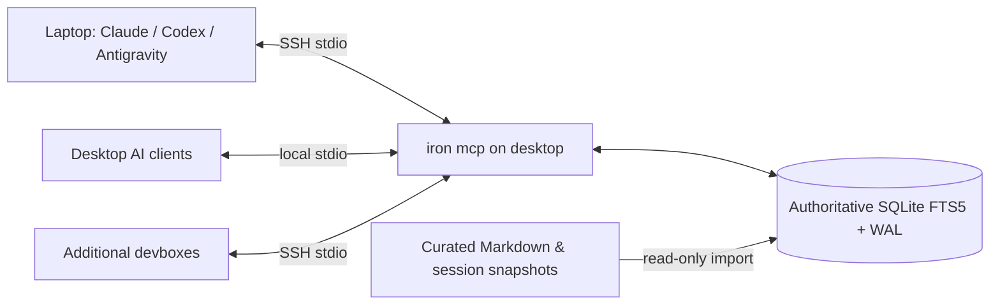

# Iron Suite

**Zero-cloud SQLite FTS5 + stdio MCP memory hub (`iron`) and adversarial multi-agent engineering skills (`iron-*`) for Claude Code, Codex, Cursor, and Antigravity.**

[](LICENSE)

Iron Suite solves two recurring failures in agentic software engineering:

1. **Unbounded, noisy, cloud-locked agent memory:** `iron` indexes your curated Markdown memories and session history into a local SQLite FTS5 + WAL store, serves 4 deterministic MCP tools over `stdio` (locally or across machines via plain `ssh`), enforces **hard UTF-8 byte budgets (`--max-bytes`)**, and scrubs credentials/private spans before indexing — with **zero vector databases, zero hosted APIs, and zero background daemons**.
2. **rubber-stamp "looks good" AI coding loops:** The bundled **7 `iron-*` skills** and **7 role-isolated subagents** enforce bounded ownership (`irondev`), fresh-context adversarial code & security review (`irondev-review`), offensive vulnerability hunting with `1 -> N` structural variant sweeps (`iron-hunt`), measurement-first performance profiling (`iron-perf`), systematic production forensics (`iron-debug`), and read-only architecture/security audits (`iron-audit`).

---

## Quick Install

### One-Command Install (Binary + Skills + Agents + Claude MCP)
```sh
curl -fsSL https://raw.githubusercontent.com/arielonoriaga/iron-suite/main/install.sh | bash
```

### Install Skills Only (`skills.sh` — Claude Code, Codex, Cursor, Antigravity)
```sh
npx skills add arielonoriaga/iron-suite
```

### Claude Code Plugin Marketplace
```text
/plugin marketplace add arielonoriaga/iron-suite
/plugin install iron-suite@iron-suite-marketplace
```

### Cargo / `cargo-binstall` (`iron` Memory CLI + MCP Server)
```sh
cargo binstall iron-suite
# or from source:
cargo install --git https://github.com/arielonoriaga/iron-suite --locked
```

---

## What's Inside

### 1. `iron` — Bounded-Byte SQLite FTS5 Memory CLI & MCP Hub

```sh
# Import curated Markdown memories (and optional Cavemem SQLite history) read-only
iron memory import --claude-root ~/.claude --cavemem-db ~/.cavemem/data.db

# Search with a strict serialized UTF-8 byte ceiling
iron memory search 'cargo target directory' --repo . --max-bytes 2000
iron memory search 'tenant isolation' --project commerce-core --strict-project

# Paginated byte-exact fetch & explicit Markdown graph traversal
iron memory get mem_ID --max-bytes 4000
iron memory related mem_ID --relation references
iron context 'migration rollback' --project commerce-core --role reviewer

# Save durable native notes & verified active-WAL backups
iron memory remember --project iron-suite --agent claude --kind decision \
  --title 'Shared memory hub' --content 'Desktop holds the authoritative Iron store.'
iron memory backup --output ~/backups/iron-snapshot.db
```

#### MCP Server (`iron mcp`)
Exposes 4 tools over newline-delimited JSON-RPC `stdio` (`2025-06-18` / `2025-03-26` / `2024-11-05`):
- `memory_search` — tokenized FTS5 retrieval with `project`, `strict_project`, `role`, `source` (`all|curated|history|native`), and `max_bytes` (`256..65536`, default `4000`).
- `memory_get` — UTF-8 byte-paginated record retrieval (`offset` / `next_offset`); accepts record IDs only, never arbitrary file paths.
- `memory_related` — traverses explicit outgoing/incoming Markdown links without inventing semantic edges.
- `memory_remember` — replay-safe native durable note persistence with `<private>` tag and credential redaction prior to hashing.

#### Zero-Cloud Multi-Machine Shared Hub over SSH
Run one authoritative SQLite WAL store on your workstation (`desktop`) and point every AI client on your laptop or remote devboxes at it over authenticated SSH — no sync conflicts, no open ports, no third-party cloud:



```json
{
  "mcpServers": {
    "iron-memory": {
      "command": "ssh",
      "args": ["-T", "-o", "BatchMode=yes", "-o", "ConnectTimeout=12", "desktop", ".local/bin/iron", "mcp"]
    }
  }
}
```

See [docs/ssh-hub-rollout.md](docs/ssh-hub-rollout.md) and `integration/` for `systemd --user` refresh and 3-2-1 `gitleaks`-gated backup timers.

---

### 2. Bundled `iron-*` Skills (`skills/`) & Subagents (`agents/`)

| Skill | Purpose |
| :--- | :--- |
| **`irondev`** | End-to-end feature/fix orchestrator: bounded implementer brief -> fresh-context review -> real-surface verification -> curated learning. |
| **`irondev-dev`** | Shared implementation discipline for backend, frontend, and security engineering roles with canonical handoff contracts. |
| **`irondev-review`** | Fresh-context adversarial code review selecting correctness, architecture, systems, and security lenses proportional to change risk. |
| **`iron-hunt`** | Proactive read-only/sandboxed offensive vulnerability hunter: attack-surface mapping, scanner triage (`gitleaks`, `osv-scanner`, `semgrep`, `zizmor`, `ast-grep`), source-to-sink taint tracing, safe local repro proof, and `1 -> N` structural variant sweeps. |
| **`iron-audit`** | Read-only multi-lens codebase health & pre-release sweep producing severity-ranked findings and remediation briefs. |
| **`iron-debug`** | Production-grade systematic debugging (`repro -> hypothesis -> instrument -> root cause -> fix -> invariant backprop`). |
| **`iron-perf`** | Measurement-first performance engineering: baseline flamegraphs, query plans, and RUM evidence before any optimization edit. |

Bundled subagents (`agents/iron-*.md`): `iron-backend-dev`, `iron-backend-review`, `iron-frontend-dev`, `iron-frontend-review`, `iron-security-dev`, `iron-security-review`, and `iron-verifier`.

---

## Design Contracts & Honest Non-Claims

- **Hard serialized UTF-8 byte budgets:** `--max-bytes` bounds the serialized JSON output (including escapes and trailing newline). Budget exhaustion sets `truncated: true` and is explicitly distinguished from `no_match: true`.
- **Evidence, not authority:** Recalled memories retain timestamps and source locators; historical notes can be stale and never override live repository verification or user authorization.
- **Best-effort redaction:** Derived-index import and `memory_remember` scrub `<private>` spans, PEM keys, bearer tokens, URL passwords, and common credential assignments, while leaving source files untouched. Heuristics do not replace secret management.
- **Independent evaluation (`eval/`):** Fixtures under `eval/` measure source recall within byte budgets, replay idempotency, and subprocess latency; they do not claim billed token or invoice savings without provider telemetry. See [docs/upstream-learnings.md](docs/upstream-learnings.md).

---

## Companion Projects in The Iron Stack

- **[claude-harness](https://github.com/arielonoriaga/claude-harness)** — Self-improving Claude Code harness: Rust `PreToolUse` command guardrail, cross-session JSONL journal bus, detached `test-agent`, auto-improve reflector, and ratatui build-queue TUI.
- **[entropy-hunter](https://github.com/arielonoriaga/entropy-hunter)** — Deterministic software-entropy analyzer CLI for Rust and TypeScript codebases.
- **[claude-statusline-bar](https://github.com/arielonoriaga/claude-statusline-bar)** — Information-dense terminal status line for Claude Code with live context, git, and rate-limit ramps.

---

## Build & Verify

```sh
cargo test --locked
python3 -m unittest discover -s eval -p test_runner.py -v
```

## License

MIT — Copyright (c) 2026 Ariel Onoriaga.
