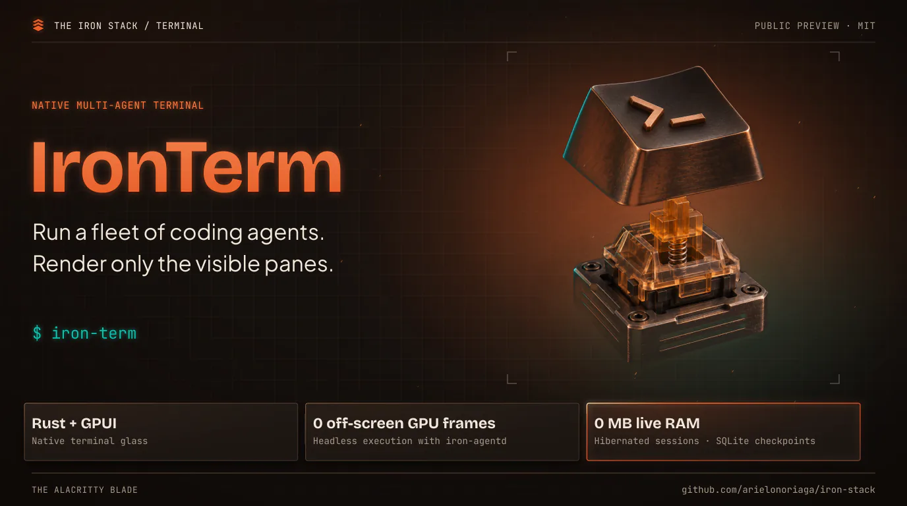
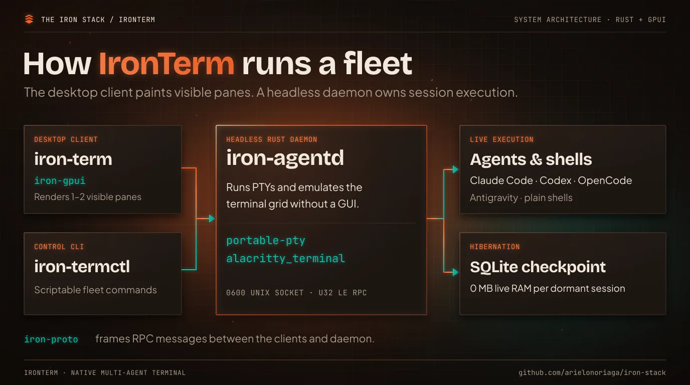
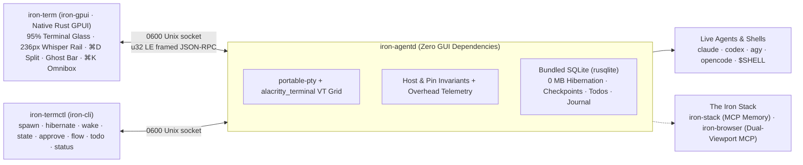

<p align="center">
  
</p>

# IronTerm

**Native Rust + GPUI multi-agent terminal and headless PTY fleet daemon (*The Alacritty Blade*): 95% raw terminal glass, `0` off-screen GPU frames, `0 MB` live-RAM session hibernation backed by SQLite, a collapsible `236px` Urgency Whisper Rail, a 1-keystroke Ghost Action Bar, and a scriptable `iron-termctl` control CLI for Claude Code, Codex, OpenCode, Antigravity, and plain shells.**

[](#status-public-preview) [](#quick-install) [](#workspace-architecture) [](LICENSE) [](https://iron.huggian.com)

> [!IMPORTANT]
> **Status: Public Preview (`v0.1.0`).** IronTerm is an active open-source Rust + GPUI workspace (`iron-proto`, `iron-agentd`, `iron-gpui`, `iron-cli`) built and dogfooded on Linux (Wayland & X11). Core daemon hibernation, native GPUI terminal rendering, Whisper Rail, split panes, Ghost Action Bar, Fleet Overlay, Omnibox, and `iron-termctl` are working today; multi-host SSH auto-bridging, portable non-`tmux` adapters, and companion mobile triage are actively evolving. See [Honest Scope & Roadmap](#honest-scope--roadmap).

IronTerm solves the two failure modes that hit engineers running **10–25+ concurrent AI coding agents** across sibling git worktrees and multi-day sessions:

1. **Terminal & GPU bloat from off-screen sessions:** Running a dozen GPU-rendered terminal windows burns VRAM, CPU wakeups, and battery for agents you are not even looking at — while closing tabs loses scrollback, task state, and *"where I left off"* context.
2. **Dashboard chrome stealing terminal pixels:** Heavy web-based agent dashboards bury the actual PTY behind cards and modals instead of giving you razor-sharp native terminal glass with calm peripheral urgency awareness.

IronTerm decouples **execution (`iron-agentd`)** from **rendering (`iron-gpui`)**: only the 1–2 visible panes paint GPU frames, background sessions run headlessly in `portable-pty` + `alacritty_terminal`, and hibernated sessions drop to **`0 MB` live RAM** while preserving SQLite checkpoints, todo checklists, workflow phases, and `--resume` commands.

---

## Why IronTerm?

| Capability | Classic Terminal + `tmux` | Web / Electron Agent Dashboards | **IronTerm (`Rust + GPUI`)** |
| :--- | :--- | :--- | :--- |
| **Native GPU Glass (Zero WebView Overhead)** | Yes | No (Chromium per window) | **Yes (Native Rust + GPUI · 95% terminal pixels)** |
| **Off-Screen Agent GPU Paint Cost** | Varies by multiplexer | High (DOM + canvas) | **0 off-screen GPU frames (`iron-agentd` headless)** |
| **Multi-Day Session Hibernation** | Live processes stay in RAM | Live tabs stay in RAM | **`0 MB` live RAM + SQLite checkpoint & `--resume`** |
| **Urgency Triage Across 20+ Agents** | Manual pane hunting | Heavy card grids | **Collapsible `236px` Whisper Rail (`NEEDS YOU` · `ACTIVE` · `DORMANT`)** |
| **1-Keystroke Guardrail & Approval Prompts** | Switch pane + type reply | Mouse clicks | **`28px` Ghost Action Bar (`Ctrl+1`/`2`/`3` or `Alt+1`/`2`/`3`)** |
| **Scriptable Agent Hook Control Plane** | Ad-hoc `tmux send-keys` | Custom HTTP webhooks | **Native `iron-termctl` over `0600` Unix socket (`u32 LE` RPC)** |
| **Part of The Iron Stack** | Standalone | Standalone | **Native sibling to `iron-stack` & `iron-browser`** |

---

## Architecture

<p align="center">
  
</p>



### Workspace Architecture

| Crate | Binary / Lib | Responsibility |
| :--- | :--- | :--- |
| **[`crates/iron-proto`](crates/iron-proto)** | `iron_proto` | Length-prefixed (`u32 LE`) sync/async framing, OSC title/state parsing, and typed RPC/fleet/grid/prompt wire types. |
| **[`crates/iron-agentd`](crates/iron-agentd)** | `iron-agentd` | Zero-GUI headless Rust daemon: `portable-pty` spawning, `alacritty_terminal` headless VT emulation, `0 MB` hibernation & wake via bundled SQLite (`rusqlite`), host policy invariants, and `0600` Unix socket RPC server. |
| **[`crates/iron-gpui`](crates/iron-gpui)** | `iron-term` | Native GPUI desktop client (*The Alacritty Blade*): Celestial Dark & Light themes, collapsible `236px` Whisper Rail, 2-pane split, `28px` Ghost Action Bar, `27px` statusline, Fleet Overlay, and fuzzy Omnibox. |
| **[`crates/iron-cli`](crates/iron-cli)** | `iron-termctl` | Scriptable control-plane & agent-hook CLI (`ping`, `status`, `spawn`, `hibernate`, `wake`, `state`, `checkpoint`, `flow`, `todo`, `approve`, `move`, `host-mode`, `inspect`) with `--json` output. |

---

## Quick Install

### Prerequisites
- **Rust** (`cargo`, stable with Rust 2024 edition support — ≥ `1.85`)
- **Linux** (Wayland or X11 with Vulkan/Mesa drivers for GPUI)

```bash
git clone https://github.com/arielonoriaga/iron-term.git
cd iron-term

# Build & install binaries, hicolor icons, and XDG desktop entry (~/.local/bin & ~/.local/share)
./packaging/install-desktop.sh
```

### Launch

```bash
# Launch IronTerm (auto-bootstraps iron-agentd on $XDG_RUNTIME_DIR/iron-term/agentd.sock)
iron-term

# Launch in a specific directory or run a command directly
iron-term --working-directory ~/Projects/my-app
iron-term --new-session --title "build" --command bash -lc "cargo test"

# Celestial Light theme
iron-term --light
```

---

## Keyboard Workflow (`iron-term`)

| Shortcut | Action |
| :--- | :--- |
| **`Ctrl+\`** | Collapse / expand the `236px` monospace **Urgency Whisper Rail** (`100%` pure terminal glass when collapsed) |
| **`Ctrl+D`** | Toggle 2-pane native split view |
| **`Ctrl+K`** | Open **Omnibox** fuzzy session switcher & quick spawner |
| **`Ctrl+B`** | Toggle **Fleet Overlay** (host headroom, active/dormant sessions) |
| **`Ctrl+1` / `2` / `3`** *(or `Alt+1` / `2` / `3`)* | Resolve active **Ghost Action Bar** prompt when visible (passes straight through to PTY when no prompt is active) |
| **`Ctrl+Shift+C` / `Ctrl+Shift+V`** | Copy / Paste (without sending `SIGINT` to the PTY) |
| **`Ctrl+Shift+D`** | Send `EOF` (`0x04`) cleanly to the focused PTY |

---

## Control Plane & Agent Hooks (`iron-termctl`)

Every session spawned by `iron-agentd` can report structured state, checkpoints, workflow phases, checklists, and guardrail prompts directly to the daemon over `$IRON_TERM_SOCKET`:

```bash
# Inspect daemon health and fleet overhead (live GPU panes vs headless vs 0 MB hibernated)
iron-termctl ping
iron-termctl status --json

# Spawn a headless agent session
iron-termctl spawn --title "api · auth-fix" --project my-app --cli claude -- claude

# Update attention state or emit a 1-keystroke Ghost Action Bar prompt
iron-termctl state --session <id> --state waiting \
  --kind guardrail --title "Heavy cargo build" \
  --fix-label "Run via queue" --fix-cmd "cargo test --workspace"

# Update live workflow phases, checklists, and 1-line "where I left off" checkpoints
iron-termctl flow --session <id> --phase verify --phases brief,build,review,verify
iron-termctl todo --session <id> "done:Parse wire frame" "active:Run E2E" "todo:Tag release"
iron-termctl checkpoint --session <id> "All 40 workspace tests green; awaiting final review"

# Hibernate an idle session to 0 MB live RAM, then wake it later
iron-termctl hibernate <id> --checkpoint "Paused before release cut"
iron-termctl wake <id>

# Approve a waiting prompt, move a session, or switch host mode
iron-termctl approve <id> --action primary
iron-termctl move <id> --host workstation
iron-termctl host-mode laptop shared
iron-termctl inspect <id>
```

---

## Honest Scope & Roadmap

- **Working today (`v0.1.0`):**
  - Headless `iron-agentd` daemon with `portable-pty`, `alacritty_terminal`, bundled SQLite persistence, `0 MB` hibernation/wake, and `0600` Unix socket RPC (`u32 LE`).
  - Native `iron-gpui` desktop client (`iron-term`) with Whisper Rail, 2-pane split, Ghost Action Bar, 27px statusline, Fleet Overlay, Omnibox, Celestial Dark/Light themes, and modal-safe keyboard routing.
  - Full `iron-termctl` CLI (`ping`, `status`, `spawn`, `hibernate`, `wake`, `state`, `checkpoint`, `flow`, `todo`, `approve`, `move`, `host-mode`, `inspect`) and XDG `.desktop` packaging.
- **In active development:**
  - Clean Markdown transcript overlay (`Cmd+M`) and expandable 420px side inspector sheet inside `iron-gpui`.
  - Portable multi-host SSH auto-bridging (`ssh -T <host> iron-termctl stdio-bridge`) and setup-agnostic host discovery (zero hardcoded hostnames or multiplexer assumptions).
  - Opt-in loopback/Tailscale `390px` mobile approval companion.

---

## Build & Verify

```bash
cargo clippy --workspace --all-targets -- -D warnings
cargo test --workspace --no-fail-fast
cargo build --release --workspace
```

---

## The Iron Stack

IronTerm is part of **[The Iron Stack](https://iron.huggian.com)** — zero-cloud, local-first Rust & TypeScript developer tools built for high-trust multi-agent engineering:

1. **[`iron-stack`](https://github.com/arielonoriaga/iron-stack):**
   Zero-cloud SQLite FTS5 + Hybrid Semantic RRF `stdio` MCP memory hub (`iron`), local **Second Brain & Trust Desk Web UI** (`iron ui`), SSH multi-machine memory sharing, and **9 adversarial `iron-*` engineering & UX skills**.
2. **[`iron-browser`](https://github.com/arielonoriaga/iron-browser):**
   Dual-viewport (`390×844` Portrait + `1280×720` Landscape) Chromium developer browser with 3-tier mirrored input, single-flight HTTP/WS/SSE/SFS2X dedup, WebGL draw-call/render-order inspector, off-thread V8 CPU & Heap profilers, embedded multi-CLI Agent Chat Dock, causal Rust `TabEventBus`, and 26-tool Rust MCP server.
3. **`iron-term` (*This Repo*):**
   Native **Rust + GPUI** multi-agent terminal (`iron-gpui`), headless PTY daemon with `0 MB` session hibernation (`iron-agentd`), and control CLI (`iron-termctl`).

Explore the full stack at **[iron.huggian.com](https://iron.huggian.com)**.

## License

MIT — Copyright (c) 2026 Ariel Onoriaga. See [LICENSE](LICENSE).
